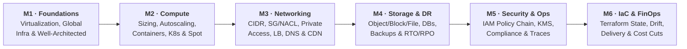

# ☁️ Cloud Infrastructure & Services
### `25CS2206E` · Complete Course Syllabus & Tri-Cloud Engineering Roadmap

  <em>Designing, provisioning, securing, diagnosing, and financially optimizing cloud-native infrastructure—built tri-cloud across AWS, Azure, and Google Cloud and aligned with CLF-C02, SAA-C03, and CompTIA Cloud+ (CV0-004).</em>

---

[What You Will Learn](#what-you-will-learn) •
[Tech Stack](#tech-stack) •
[Curriculum Map](#curriculum-map) •
[Core Models](#core-models) •
[6 Core Modules](#syllabus) •
[Course Outcomes](#outcomes) •
[12-Week Labs](#labs) •
[Break-Fix & Diagnostics](#diagnostics) •
[Evaluation](#evaluation) •
[Resources](#resources)

> [!IMPORTANT]
> **Course Scope & Engineering Philosophy:** Every architectural choice in the cloud carries both an operational trade-off and a real monetary cost. This course teaches **tri-cloud infrastructure engineering**—using **AWS** as the primary platform alongside **Azure** and **Google Cloud** equivalence across every module—and aligns directly with **AWS Cloud Practitioner (`CLF-C02`)**, **AWS Solutions Architect Associate (`SAA-C03`)**, and **CompTIA Cloud+ (`CV0-004`)**. *(Curriculum progression: `OSSP` & `DEDB` → `CDIS (25CS2206E)` → `CICD` & `SDSR`.)*

---

## ✨ What You Will Learn

Rather than memorizing cloud console menus, this course treats cloud infrastructure as a **reproducible, measurable, and cost-governed systems discipline** across six core pillars:

| Pillar | Core Competencies & Cloud Engineering Skills |
| :--- | :--- |
| **1. Cloud Foundations & Virtualization** | Map responsibility across `On-Prem` → `IaaS` → `PaaS` → `SaaS` → `FaaS`/`CaaS`; analyze hypervisors and `vCPU steal`; evaluate global regions, availability zones, and sovereign deployments; apply the **Well-Architected Framework** and **7 Rs** migration model; and compute empirical TCO. |
| **2. Compute, Containers & Scaling** | Right-size compute from $p_{95}$ utilization rather than peak; model autoscaling ramp-rate vs. warm-up limits; build multi-stage containers with BuildKit; understand **Kubernetes** as a reconciliation loop (`etcd`, scheduling, eviction, `StatefulSet`); evaluate serverless cold starts; and optimize On-Demand, Commitment, and Spot coverage. |
| **3. Cloud Networking & Delivery** | Plan non-overlapping CIDR subnets across multi-AZ public/private tiers; separate stateful Security Groups from stateless Network ACLs; use private Gateway/Interface endpoints to eliminate NAT processing costs; engineer L4/L7 load balancing, DNS routing policies, CDNs, and hybrid circuits; and diagnose faults in four commands. |
| **4. Storage, Data & Disaster Recovery** | Select Object, Block, and File storage at the protocol level (`RAID`, `LUNs`, thin provisioning); model object storage lifecycle and retrieval fees; defend against ransomware with Versioning + Object Lock; distinguish Multi-AZ availability from Read-Replica scale; verify restores; and price DR postures against **RTO/RPO**. |
| **5. Identity, Security & Observability** | Trace IAM policy evaluation gate-by-gate (SCPs, permission boundaries, explicit denies); replace static keys with temporary workload roles; design multi-account governance, KMS envelope encryption, and audited secret rotation; enforce WAF/DDoS edge protection; and audit alerts across metrics, logs, and traces. |
| **6. IaC, Operations & FinOps** | Provision reproducible infrastructure via versioned **Terraform** modules with locked remote state; compare portable vs. native IaC (`CloudFormation`/`CDK`, `Bicep`, `Deployment Manager`); resolve state corruption and drift; and cut real cloud bills against a published SLO using cost attribution, anomaly detection, and transfer analysis. |

---

## 🛠️ Tri-Cloud Infrastructure & Tooling Stack

| Domain | Core Platforms & Tools | Services, Primitives & Equivalents |
| :--- | :--- | :--- |
| **Tri-Cloud Providers** | -1D4ED8?style=flat-square&logo=amazonwebservices&logoColor=white)   | Regions · Availability Zones · Region Pairs · Edge / Local Zones |
| **Compute & Orchestration** |    | `EC2` · `ECS Fargate` · `EKS / AKS / GKE` · `Lambda` · `etcd` · `kubectl` |
| **Networking & Data** |    | `CIDR` · `SG / NACL` · `S3 / EBS / EFS` · `RDS Multi-AZ` · `Redis` · `SQS` |
| **Security & Observability** |   | `Organizations / SCP` · `Envelope Encryption` · `WAF` · `X-Ray` · `Flow Logs` |
| **IaC & Cloud FinOps** |    | Remote State & Locking · `CloudFormation / Bicep` · `CUR` · `Budgets` · `SSM` |

---

## 🗺️ Curriculum Architecture Map

---

## 📐 Core Decision & Quantitative Models Covered

| Engineering Problem | Analytical Rule / Relation | Decision Criterion |
| :--- | :--- | :--- |
| **Reactive Autoscaling Viability** | $t_{\text{warm-up}} + t_{\text{detect}} < t_{\text{ramp}}$ | If instance boot + metric lag exceeds traffic ramp time, reactive scaling fails—use scheduled, predictive, or serverless compute |
| **Client-Experienced DNS Failover** | $T_{\text{failover}} = T_{\text{health-check}} + T_{\text{propagation}} + \text{TTL}_{\text{cached}}$ | DNS TTL sets a hard lower bound on recovery time seen by real clients, often $5\times$ longer than console failover |
| **Usable Hosts per IPv4 Subnet** | $H_{\text{usable}} = 2^{32 - \text{prefix}} - N_{\text{reserved}}$ | Accounts for cloud provider subnet reservations (e.g., `5` IPs reserved per subnet in AWS/Azure vs. `2` in standard CIDR) |
| **Disaster Recovery Tiering** | $\text{Cost} \propto \frac{1}{\text{RTO}} + \frac{1}{\text{RPO}}$ | Selects the lowest-cost posture (`Backup & Restore` → `Pilot Light` → `Warm Standby` → `Multi-Site`) meeting both targets |
| **IAM Policy Evaluation** | $\text{Allow} \iff (\neg \text{Explicit Deny}) \land (\text{All Gates Allow})$ | Every applicable layer (SCP, Resource Policy, Permission Boundary, Session Policy, Identity Policy) must permit the action |
| **Commitment Coverage** | $\min_{C}\; \sum_{t} \Big(p_{\text{commit}} C + p_{\text{od}}\max(0, U_t - C)\Big)$ | Finds the optimal Savings Plan / Reservation baseline floor $C$ across an hourly utilization series $U_t$ |

---

## 📚 Detailed Module-Wise Syllabus

### 🔹 Module 1 · Cloud Foundations, Virtualization, and the Well-Architected Way (`CO1`)
> **Focus:** Shared responsibility boundaries, virtualization mechanics, global failure domains, Well-Architected trade-offs, and multi-tier request tracing across AWS, Azure, and GCP.

* **Service & Deployment Models:** Responsibility shifts across `On-Premises` → `IaaS` → `PaaS` → `SaaS` → `FaaS`/`CaaS`; attributing failures to the provider vs. customer side; distinguishing all five deployment models (**public, private, community, hybrid with cloud bursting, and multicloud**) plus sovereign cloud regions.
* **The Virtualization Substrate:** How hypervisors multiplex physical hosts; **vCPU steal time** and why a VM can report low CPU utilization while its application stalls.
* **Global Infrastructure (Tri-Cloud):** Separating the geographic unit (data residency, pricing) from the failure-isolation unit; regions, availability zones, paired regions, and local/edge zones across AWS, Azure, and Google Cloud.
* **Well-Architected & Migration Economics:** Applying the Well-Architected Framework pillars to eliminate non-compliant designs; migration strategies (**the 7 Rs**); computing honest **Total Cost of Ownership (TCO)** for variable vs. flat, fully utilized workloads.
* **End-to-End Request Tracing:** Reading a single HTTP response's headers to infer a multi-tier architecture (`CDN` → `Proxy/LB` → `Application` → `Cache` → `Database`).

### ⚡ Module 2 · Compute, Scaling, and Workload Placement (`CO2`)
> **Focus:** Right-sizing from utilization percentiles, reactive vs. predictive scaling limits, container & Kubernetes internals, serverless trade-offs, and purchasing models.

* **Sizing & Autoscaling Mechanics:** Computing $p_{95}$ utilization from real telemetry to eliminate over-provisioning; comparing **target-tracking, step, scheduled, and predictive** scaling policies; diagnosing when warm-up duration exceeds workload ramp speed.
* **Containers at the Runtime Level:** Image layering, **BuildKit** cache mounts, multi-stage builds that shrink image sizes by an order of magnitude, container registries, persistent volumes, and container networking.
* **Kubernetes as a Reconciliation Loop:** Control plane internals (`API server`, `etcd`, `scheduler`, `controller manager`), workload objects and ownership chains (`Deployment`, `StatefulSet`, `ReplicaSet`), resource requests/limits, scheduling failures, pod eviction, RBAC, `PodSecurity`, and graceful node drains.
* **Serverless & Purchasing Economics:** Functions vs. serverless containers (cold starts, timeouts, execution limits); **On-Demand** vs. **Commitments** (Savings Plans, Reserved Instances, Committed Use Discounts) vs. **Spot/Interruptible** capacity; hourly coverage analysis; building a workload-to-compute decision table.

### 🌐 Module 3 · Networking, Connectivity, and Content Delivery (`CO3`)
> **Focus:** Non-overlapping cloud address architecture, stateful/stateless security boundaries, private service endpoints, L4/L7 traffic routing, CDNs, and disciplined fault isolation.

* **Cloud Address Planning:** Mental CIDR arithmetic, non-overlapping VPC/VNet allocation (preventing peering collisions), usable host counts, and standard multi-zone public/private/isolated subnet tiers.
* **Stateful vs. Stateless Filtering:** **Security Groups** vs. **Network ACLs** (and Azure NSG / GCP Firewall equivalents); diagnosing asymmetric return-traffic blocks and ephemeral-port traps.
* **Private Service Access (Security + Cost):** **Gateway** and **Interface** endpoints; keeping high-volume storage and service traffic off the public internet and bypassing costly NAT Gateway data-processing charges.
* **Load Balancing, DNS & Edge Delivery:** L4 vs. L7 load balancers and health-check semantics; DNS routing policies (**failover, geolocation/residency, latency**); measuring true client-side DNS failover including resolver TTL caching; **CDNs**, hybrid connectivity (VPN, dedicated circuits), hub topologies, and VPC flow logs.
* **Structured Network Diagnostics:** Following the **`resolve` → `route` → `reach` → `respond`** diagnostic order; distinguishing timeouts from connection refusals to localize faults with minimal commands.

### 💾 Module 4 · Storage, Data Services, Backup, and Disaster Recovery (`CO4`)
> **Focus:** Protocol-level storage engineering, object-tier economics, relational vs. NoSQL scaling, verified backup chains, and RTO/RPO-priced disaster recovery.

* **Protocol-Level Storage:** Choosing **Object, Block, and File** storage by access pattern before price; **RAID**, **LUNs**, and how **thin provisioning** fails silently until capacity exhaustion is total.
* **Object Storage Economics & Immutability:** Storage tiers, lifecycle transition rules, minimum storage durations, and unbudgeted retrieval charges; combining **Versioning + Object Lock (WORM)** as an immutable defense against ransomware.
* **Managed Databases & Data Pipelines:** Why **availability is not scale** (**Multi-AZ synchronous standby** vs. **Read Replicas**); selecting NoSQL stores (key-value, wide-column) by access pattern; caching (`cache-aside`), consistency models, data warehouses, query-in-place analytics, streaming, ETL, queues, event buses, and workflow orchestration.
* **Verified Backups & Priced DR:** Full, incremental, and differential backup chains; scheduled restore verification to prove backups are not mere hypotheses; comparing **Backup & Restore, Pilot Light, Warm Standby, and Multi-Site** against strict **RTO/RPO** budgets.

### 🛡️ Module 5 · Identity, Security, Compliance, and Observability (`CO5`)
> **Focus:** Deterministic IAM policy evaluation, least-privilege workload identity, multi-account guardrails, envelope encryption, edge defense, and actionable observability.

* **Policy Evaluation as an Algorithm:** Stepping through the full policy evaluation chain (**explicit deny, SCPs, resource policies, permission boundaries, session policies, identity policies**) to explain why even an administrator can receive `AccessDenied`.
* **Workload Identity & Multi-Account Governance:** Eliminating static long-lived credentials via temporary roles proven by denial tests; **Organizations, Organizational Units (OUs), Service Control Policies (SCPs)**, workforce SSO, customer identity, and federation.
* **Encryption, Secrets & Compliance:** **KMS envelope encryption**, key policies, and scalable key rotation; managed secret stores with automatic rotation verified in audit trails; continuous configuration compliance, immutable audit logs, posture hubs, data discovery, hardening baselines, **WAF**, **DDoS** mitigation, and threat detection.
* **Observability & Alert Hygiene:** Correlating **metrics, logs, and distributed traces** around the Four Golden Signals; auditing alert actionability rates so alerts page humans only when intervention is required.

### 🏗️ Module 6 · Infrastructure as Code, Delivery, Operations, and Cost Engineering (`CO6`)
> **Focus:** Reproducible Terraform workflows, state recovery, drift management, operational lifecycle automation, and SLO-safe Cloud FinOps.

* **Infrastructure as Code & State Mechanics:** Managing **Terraform** remote state backends, locking, and concurrent modification hazards; breaking and recovering state safely; choosing between portable IaC (**Terraform**) and native IaC (**CloudFormation/CDK, Bicep/ARM, Deployment Manager**).
* **Modularization, Drift & Operations:** Refactoring flat configs into versioned reusable modules; multi-account rollout pipelines; detecting infrastructure **drift** and deciding whether to codify or revert; deployment strategies, configuration management, patch orchestration, and operational runbooks.
* **Cloud FinOps & Cost Engineering:** Decomposing detailed billing exports (`CUR`); identifying hidden data-transfer charges (**NAT processing, cross-AZ traffic, internet egress**); enforcing mandatory tagging to expose unowned spend; tag-scoped anomaly detection; commitment coverage analysis; reducing cloud spend without violating a published SLO; and understanding support tiers and free-tier boundaries.

---

## 🎓 Course Outcomes (COs)

| CO | Outcome Statement | Bloom's Level |
| :---: | :--- | :---: |
| **CO1** | **Analyze** cloud service and deployment models, the virtualization substrate beneath them, and the shared-responsibility boundary across AWS, Azure, and GCP; and trace a single user request through every layer of a deployed multi-tier system. |  |
| **CO2** | **Evaluate** compute options—virtual machines, containers, orchestration platforms, and serverless functions—across the three major providers, selecting sizing, placement, scaling policy, and purchasing model for stated workload, latency, and cost constraints. |  |
| **CO3** | **Analyze** cloud network architecture—address planning, virtual networks, stateful/stateless filtering, private service access, L4/L7 load balancing, DNS routing policies, content delivery, and hybrid connectivity—and diagnose connectivity, routing, and name-resolution faults from evidence. |  |
| **CO4** | **Evaluate** storage and data services—object, block, and file at protocol level, managed relational/NoSQL stores, caches, and analytics—by access pattern, durability, latency, and unit cost; and design a backup and DR posture meeting a stated RTO and RPO. |  |
| **CO5** | **Analyze** cloud identity, security posture, regulatory compliance, and observability—policy evaluation logic, multi-account governance, federation, key/secret management, edge protection, hardening baselines, audit trails, metrics, logs, and traces—applying least privilege end-to-end. |  |
| **CO6** | **Evaluate** and apply Infrastructure-as-Code, deployment strategies, operational lifecycle practice, and cost-engineering techniques to provision, release, operate, and financially optimize cloud infrastructure reproducibly against measured operational and monetary cost. |  |

---

## 🧪 12-Week Hands-On Lab Progression

<b>Click to expand / collapse the 12 Weekly Engineering Labs (CO1 – CO6)</b>

| Week | Module | Hands-On Lab & Quantitative Exercise | Core Verification Outcome |
| :---: | :---: | :--- | :--- |
| **W01** | `M1 · CO1` | Multi-tier HTTP request tracing, budget-alarm provisioning, and programmatic shared-responsibility classification | Live controls classified by provider vs. customer ownership |
| **W02** | `M1 · CO1` | Empirical Total Cost of Ownership (TCO) sensitivity modeling & 7 Rs migration mapping | Defensible TCO math for variable vs. flat capacity |
| **W03** | `M2 · CO2` | Right-sizing compute from $p_{95}$ telemetry & building a ramp-vs-warm-up autoscaling simulator | Proof of when reactive autoscaling can or cannot keep up |
| **W04** | `M2 · CO2` | Multi-stage Docker/BuildKit image reduction, Kubernetes control-plane & workload drills, and hourly commitment coverage analysis | Order-of-magnitude smaller image + optimal Savings/Spot mix |
| **W05** | `M3 · CO3` | Scripted non-overlapping CIDR address planning, multi-AZ VPC build, and Gateway Endpoint cost/security validation | Verified collision-free address space bypassing NAT Gateway |
| **W06** | `M3 · CO3` | Client-side DNS failover measurement (health check + propagation + cached TTL) & multi-tier network fault localization | Measured real client recovery time & 4-command fault logs |
| **W07** | `M4 · CO4` | Access-pattern storage tiering and object lifecycle cost modeling (minimum duration & retrieval fees) | Verified lifecycle rules that avoid hidden retrieval penalties |
| **W08** | `M4 · CO4` | End-to-end backup verification into a scratch instance & timed cross-region DR failover comparison | Wall-clock achieved RTO/RPO vs. theoretical design targets |
| **W09** | `M5 · CO5` | Gate-by-gate IAM effective permission evaluator & iterative least-privilege role scoping with denial tests | Deterministic policy trace surfacing SCP & boundary blocks |
| **W10** | `M5 · CO5` | KMS envelope encryption, audited secret rotation, compliance evidence checks, and historical alert actionability audit | Proven rotation in audit trail + low-noise alert thresholds |
| **W11** | `M6 · CO6` | Modularizing versioned Terraform configurations, intentional state-file corruption & recovery, and drift remediation | Clean remote-state recovery & codify-vs-revert workflow |
| **W12** | `M6 · CO6` | Billing export (`CUR`) spend attribution, unowned-resource discovery, and SLO-preserving cloud bill optimization | Quantified cost reduction verified against latency/availability SLO |

---

## 🔍 Performance-Based Break-Fix & Diagnostic Patterns

A defining element of this course is **diagnostic economy**: diagnosing injected production faults systematically before modifying any resource.

| Module | Break-Fix Scenario | Primary Failure Surfaces & Signals |
| :---: | :--- | :--- |
| **M1** | **Responsibility Misattribution** | Separating cloud-provider substrate incidents from customer-owned misconfigurations |
| **M2** | **It Will Not Scale** | Saturated compute with stalled autoscaling (policy ceilings, cooldowns, warm-up lag, quota/eviction limits) |
| **M3** | **The Tiers Cannot Talk** | Isolating single-control breaks across route tables, Security Groups, stateless NACLs, subnet associations, or DNS |
| **M4** | **Restore Under Time** | Point-in-time data recovery from corrupted state under strict wall-clock RTO/RPO verification |
| **M5** | **`AccessDenied` With No Obvious Cause** | Tracing silent authorization blocks across explicit denies, SCPs, permission boundaries, trust policies, or resource policies |
| **M6** | **Drift & Cost Spike Together** | Detecting out-of-band console drift alongside sudden billing anomalies (NAT/egress/orphan compute) via state plans & tags |

<b>Click to expand / collapse Cloud Troubleshooting & Cost-Diagnosis Quick Reference</b>

| Observed Symptom | Underlying Class / Mechanism | First Diagnostic / Engineering Action |
| :--- | :--- | :--- |
| **Name does not resolve** | DNS resolution / hosted-zone fault | Query resolver & authoritative records (`dig`) |
| **Resolves, then times out** | Network path drop (SG, NACL, route table) | Trace route & inspect stateful/stateless rules + Flow Logs |
| **Connection refused immediately** | Target reachable; application/port not listening | Verify target service status, port binding & health checks |
| **Works small, fails on large payloads** | Path MTU mismatch or load-balancer idle timeout | Check tunnel/VPN MTU overhead & proxy timeout settings |
| **Bill dominated by data transfer** | NAT Gateway processing, cross-AZ chatter, or egress | Add Gateway/Interface endpoints, co-locate AZ traffic & use CDN |
| **Storage bill grows while active usage is flat** | Missing lifecycle transitions, uncleaned versions, or orphan snapshots | Model & apply lifecycle expiration + orphan sweep |

---

## 📊 Assessment & Evaluation Scheme

| Component | Weightage | Assessment Focus & Format |
| :--- | :---: | :--- |
| **Continuous — Break-Fix Labs** | **18%** | Six performance-based labs (one per module), graded on diagnostic economy and empirical evidence |
| **Continuous — Weekly Increments** | **12%** | Evidence-backed weekly engineering deliverables, design-decision cost logs, and teardown discipline |
| **Checkpoint 1 (Week 4)** | **15%** | Timed **AWS `CLF-C02`** mock exam + break-fix diagnostic viva |
| **Checkpoint 2 (Week 8)** | **20%** | Back-to-back **AWS `SAA-C03`** & **CompTIA `CV0-004`** mocks + network diagnosis & timed restore drill |
| **Checkpoint 3 (Week 12)** | **35%** | Full mocks across all three certifications + 25-minute panel defense of architecture and FinOps trade-offs |

---

## 📖 Certifications, Books & MOOCs

### 🏆 Aligned Global Certifications
* ☁️ **AWS Certified Cloud Practitioner (`CLF-C02`)** — Cloud concepts, shared responsibility, billing, pricing, and support tiers
* 🏛️ **AWS Certified Solutions Architect – Associate (`SAA-C03`)** — Resilient, high-performing, secure, and cost-optimized architectures
* 🛠️ **CompTIA Cloud+ (`CV0-004`)** — Vendor-neutral architecture, security, deployment, operations, and structured troubleshooting

### 📘 Reference Books
| # | Title | Authors | Publisher & Edition |
| :---: | :--- | :--- | :--- |
| **1** | *AWS Certified Solutions Architect Study Guide: Associate (SAA-C03)* | Ben Piper & David Clinton | Sybex / Wiley (4th Ed., 2022) |
| **2** | *AWS Certified Cloud Practitioner Study Guide: CLF-C02* | Ben Piper & David Clinton | Sybex / Wiley (2nd Ed., 2023) |
| **3** | *CompTIA Cloud+ Study Guide: Exam CV0-004* | Ben Piper | Sybex / Wiley (3rd Ed., 2024) |
| **4** | *Terraform: Up and Running — Writing Infrastructure as Code* | Yevgeniy Brikman | O'Reilly Media (3rd Ed., 2022) |
| **5** | *Kubernetes in Action* | Marko Lukša | Manning Publications (2018) |
| **6** | *Cloud Native Patterns: Designing Change-Tolerant Software* | Cornelia Davis | Manning Publications (2019) |
| **7** | *Site Reliability Engineering: How Google Runs Production Systems* | B. Beyer, C. Jones, J. Petoff & N. Murphy | O'Reilly Media (2016) |
| **8** | *Cloud FinOps: Collaborative, Real-Time Cloud Value Decision Making* | J. R. Storment & Mike Fuller | O'Reilly Media (2nd Ed., 2023) |

### 🌐 Recommended MOOCs & Companions
* 🎓 **Amazon Web Services · Coursera** — *AWS Cloud Solutions Architect Professional Certificate* *(SAA-C03 spine)*
* 🎓 **Amazon Web Services · Coursera** — *AWS Cloud Practitioner Essentials* *(CLF-C02 companion)*
* 🎓 **Google Cloud · Coursera** — *Google Cloud Fundamentals: Core Infrastructure* *(GCP tri-cloud equivalence)*
* 🎓 **Microsoft · Coursera** — *Microsoft Azure Fundamentals AZ-900 Exam Prep Specialization* *(Azure tri-cloud equivalence)*
* 🎓 **The Linux Foundation · edX** — *Introduction to Kubernetes (`LFS158`)* *(Control plane, workloads & scheduling)*
* 🎓 **IIT Kharagpur · NPTEL** — *Cloud Computing* *(Service/deployment models & virtualization foundations)*
